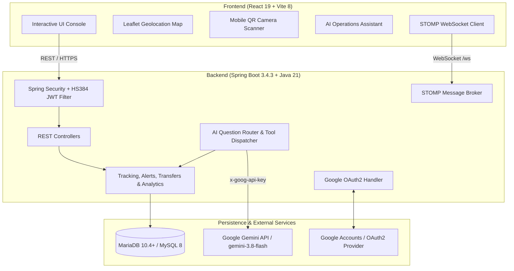
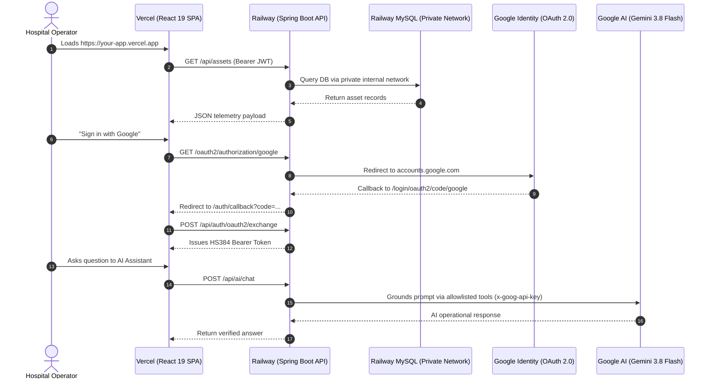

# MedTrack – AVS: Hospital Asset Tracking & Geolocation System

[](https://adoptium.net/)
[](https://spring.io/projects/spring-boot)
[](https://react.dev/)
[](https://vitejs.dev/)
[](https://mariadb.org/)
[]()

**MedTrack – AVS (Asset Verification & Geolocation Tracking System)** is an enterprise healthcare operations platform designed for real-time mobile medical equipment tracking, QR verification, geofenced perimeter monitoring, inter-departmental transfers, and AI-grounded operational intelligence.

---

## Architecture Overview



---

## Core Features

1. **Live GPS Telemetry & Geolocation Dashboard**
   - High-precision GPS coordinates, accuracy thresholds, and telemetry staleness tracking.
   - Interactive Leaflet mapping with hospital floor markers and real-time asset position updates.

2. **Mobile Camera QR Scanner & Rapid Verification**
   - In-browser mobile device camera QR scanner powered by `html5-qrcode`.
   - Instant asset lookup, maintenance verification, and quick location sync.

3. **Geofencing & Automated Alert Center**
   - Virtual polygonal and radial hospital zone boundaries.
   - Real-time intrusion/exit detection with push notifications broadcast via WebSocket STOMP.

4. **Inter-Departmental Asset Transfers & Custody Workflow**
   - Multi-step asset custody chain: Initiate &rarr; In-Transit &rarr; Received &rarr; Completed.
   - Department-level assignment filtering and historical audit trails.

5. **Advanced Operational Analytics**
   - **AMC (Asset Movement Density)**: Frequency of location updates and movement patterns.
   - **HFI (Handoff Friction Index)**: Transfer duration, dispatch delays, and reception gaps.
   - **GUB (Geo-Utilization Balance)**: Departmental equipment distribution and equilibrium index.

6. **AI Operations Assistant (Gemini Integration)**
   - Cloud AI assistant (`gemini-3.8-flash`) powered by Google Generative AI API.
   - **Zero-Hallucination Architecture**: Strictly grounded in server-side allowlisted operational tools.
   - **Prompt Injection Defense**: Rejecting mutation and override attempts at the router level.
   - **Role-Based Scope**: Enforces granular data restrictions based on authenticated staff roles.

7. **Dual Authentication & Enterprise Security**
   - Local authentication using cryptographic BCrypt password hashing.
   - Google OAuth2 social login with auto-provisioning and admin allowlists.
   - Stateless JWT authentication signed explicitly with **HMAC-SHA384 (HS384)**.
   - Fail-closed startup validation ensuring 384-bit minimum secret key entropy.

---

## Technology Stack

| Layer | Technologies |
| :--- | :--- |
| **Frontend** | React 19, Vite 8, Bootstrap 5.3, Bootstrap Icons, Leaflet, React-Leaflet, html5-qrcode, Recharts, @stomp/stompjs, Oxlint |
| **Backend** | Java 21 LTS, Spring Boot 3.4.3, Spring Security 6, Spring Data JPA, Hibernate, Spring WebSocket, Spring RestClient, JJWT (io.jsonwebtoken) |
| **Database** | MariaDB 10.4+ / MySQL 8.0+ |
| **Cloud AI** | Google Gemini Generative Language API (`gemini-3.8-flash`) via header authentication (`x-goog-api-key`) |
| **Auth Providers** | Local Database & Google Identity Services (OAuth 2.0) |

---

## Project Structure

```
MedTrack - AVS/
├── backend/
│   └── medtrack-api/
│       ├── src/
│       │   ├── main/
│       │   │   ├── java/com/medtrack/avs/
│       │   │   │   ├── config/          # Security, DataInitializer, AI, WebSocket config
│       │   │   │   ├── controller/      # REST API endpoints (Auth, Asset, Tracking, AI, etc.)
│       │   │   │   ├── dto/             # Data transfer objects & payload models
│       │   │   │   ├── entity/          # JPA entities (Asset, Transfer, Alert, User, etc.)
│       │   │   │   ├── repository/      # Spring Data JPA repositories
│       │   │   │   ├── security/        # JWT filter, JwtService, OAuth2 handlers
│       │   │   │   ├── service/         # Business logic (Tracking, Alert, Transfer, Analytics)
│       │   │   │   │   └── ai/          # AI QuestionRouter, ToolService, grounders
│       │   │   │   └── websocket/       # STOMP channel interceptors & broadcasters
│       │   │   └── resources/
│       │   │       ├── application.properties
│       │   │       └── schema.sql       # Database schema initialization
│       │   └── test/                    # Comprehensive unit, integration, & security test suite
│       ├── .env.example                 # Backend environment variable template
│       ├── .gitignore
│       └── pom.xml                      # Maven project configuration
├── public/                              # Static public web assets
├── src/
│   ├── components/                      # Reusable React components (Navbar, Sidebar, Modals)
│   ├── context/                         # AuthContext, NotificationContext, SocketContext
│   ├── pages/                           # Application views (Dashboard, LiveTracking, QR, AI, etc.)
│   ├── services/                        # Axios API clients & WebSocket STOMP connection
│   ├── App.jsx                          # Route definitions & protected layouts
│   └── main.jsx                         # Application root mount
├── .env.example                         # Root configuration template
├── .gitignore
├── index.html                           # Single Page Application HTML shell
├── package.json                         # Frontend dependencies & scripts
└── vite.config.js                       # Vite build configuration
```

---

## Prerequisites

Before running MedTrack – AVS, ensure the following software is installed on your workstation:

1. **Java Development Kit (JDK) 21 LTS**
   ```bash
   java -version
   ```
2. **Apache Maven 3.9+**
   ```bash
   mvn -version
   ```
3. **Node.js (v20+ or v22+) & npm**
   ```bash
   node -v
   npm -v
   ```
4. **MariaDB 10.4+ or MySQL 8.0+**
   ```bash
   mariadb --version
   ```

---

## Database Configuration

1. Launch your MariaDB / MySQL service on port `3306`.
2. Connect to the database server using the CLI or a GUI tool (HeidiSQL, DBeaver, phpMyAdmin) and create the database:
   ```sql
   CREATE DATABASE medtrack_db CHARACTER SET utf8mb4 COLLATE utf8mb4_unicode_ci;
   ```
3. *(Optional)* Create a dedicated application user:
   ```sql
   CREATE USER 'medtrack_user'@'localhost' IDENTIFIED BY 'your_secure_password';
   GRANT ALL PRIVILEGES ON medtrack_db.* TO 'medtrack_user'@'localhost';
   FLUSH PRIVILEGES;
   ```

---

## Environment Configuration

The application uses environment variables for all secrets, credentials, and configuration settings.

1. Navigate to `backend/medtrack-api/`.
2. Duplicate `.env.example` to create `.env`:
   ```bash
   cp .env.example .env
   ```
3. Populate the variables in `.env` with your local settings:

| Variable | Description | Example / Minimum Requirement |
| :--- | :--- | :--- |
| `DB_URL` | JDBC connection string | `jdbc:mariadb://localhost:3306/medtrack_db?useSSL=false&timezone=UTC` |
| `DB_USERNAME` | Database username | `root` or `medtrack_user` |
| `DB_PASSWORD` | Database password | Password set during DB configuration |
| `SERVER_PORT` | Backend HTTP port | `8080` |
| `JWT_SECRET` | HS384 Signing Key | **Base64 string of at least 48 bytes (384 bits)**. E.g., generate via `openssl rand -base64 48` |
| `JWT_EXPIRATION_MS` | JWT expiration duration in ms | `86400000` (24 hours) |
| `MEDTRACK_DEV_ADMIN_PASSWORD` | Optional dev password for `admin@medtrack.local` | Custom password |
| `MEDTRACK_DEV_SUPERVISOR_PASSWORD` | Optional dev password for `supervisor@medtrack.local` | Custom password |
| `MEDTRACK_DEV_STAFF_PASSWORD` | Optional dev password for `staff@medtrack.local` | Custom password |
| `GOOGLE_CLIENT_ID` | Google OAuth2 Client ID | `*.apps.googleusercontent.com` |
| `GOOGLE_CLIENT_SECRET` | Google OAuth2 Client Secret | Obtained from Google Cloud Console |
| `MEDTRACK_ADMIN_EMAILS` | Comma-separated admin email allowlist | `your.email@gmail.com` |
| `AI_PROVIDER` | AI provider | `GEMINI` |
| `AI_API_KEY` | Google Gemini API Key | Obtained from Google AI Studio |
| `AI_MODEL` | Gemini Model ID | `gemini-3.8-flash` |

> [!CAUTION]
> Never commit `.env` or paste secrets into public repositories. Both `.gitignore` files exclude `.env` by default.

---

## Google OAuth2 Setup (Optional)

To enable "Sign in with Google":

1. Open the [Google Cloud Console](https://console.cloud.google.com/).
2. Create or select a project and configure the **OAuth consent screen** (User Type: External, status: Testing or Published).
3. Add your email address under **Test users** if the app status is Testing.
4. Navigate to **Credentials** &rarr; **Create Credentials** &rarr; **OAuth client ID**.
5. Select **Web application** and configure the URIs:
   - **Authorized JavaScript origins**: `http://localhost:5173`, `http://localhost:8080`
   - **Authorized redirect URIs**: `http://localhost:8080/login/oauth2/code/google`
6. Copy the Client ID and Client Secret into your `.env` file under `GOOGLE_CLIENT_ID` and `GOOGLE_CLIENT_SECRET`.

---

## Gemini AI Assistant Setup (Optional)

To enable the AI Operations Assistant:

1. Obtain an API key from [Google AI Studio](https://aistudio.google.com/).
2. Add the key to `backend/medtrack-api/.env`:
   ```properties
   AI_PROVIDER=GEMINI
   AI_API_KEY=your_gemini_api_key_here
   AI_MODEL=gemini-3.8-flash
   ```
3. The backend communicates directly with Google's API via secure HTTPS headers (`x-goog-api-key`).

---

## Running the Application Locally

### 1. Start the Spring Boot Backend

From the project root:
```bash
cd backend/medtrack-api
mvn spring-boot:run
```
The backend initializes the database schema, seeds default departments, users, and asset records, and starts on **`http://localhost:8080`**.

### 2. Start the React Frontend

Open a second terminal at the project root:
```bash
npm install
npm run dev
```
The Vite development server will start on **`http://localhost:5173`**.

---

## Default Seed User Accounts

When the backend starts with seed passwords configured in `.env`, the following accounts are initialized:

| Role | Email | Permissions |
| :--- | :--- | :--- |
| **ADMIN** | `admin@medtrack.local` | Full hospital access, analytics, transfer approvals, user management, unrestricted AI access |
| **SUPERVISOR** | `supervisor@medtrack.local` | Departmental asset control, transfer workflows, analytics access, AI assistant |
| **STAFF** | `staff@medtrack.local` | QR scanner, active asset tracking, assigned asset inquiries |

---

## Running Tests, Builds, and Lint Checks

### Backend Automated Test Suite
```bash
cd backend/medtrack-api
mvn clean test
```
*Executes all 256 unit, integration, security, and WebSocket tests.*

### Backend Production Packaging
```bash
cd backend/medtrack-api
mvn package -DskipTests
```
*Creates the executable Spring Boot jar at `backend/medtrack-api/target/medtrack-api-1.0.0-SNAPSHOT.jar`.*

### Frontend Code Quality (Lint)
```bash
npm run lint
```
*Runs `oxlint` across all JavaScript/JSX source files.*

### Frontend Production Build
```bash
npm run build
```
*Compiles the optimized production client bundle in `dist/`.*

---

## Local URLs & Endpoints

| Service | URL | Description |
| :--- | :--- | :--- |
| **Frontend Web App** | `http://localhost:5173` | Main hospital console & dashboards |
| **API Health Endpoint** | `http://localhost:8080/api/health` | Public service health check |
| **Swagger / REST API** | `http://localhost:8080/api` | Base API endpoint |
| **WebSocket STOMP** | `ws://localhost:8080/ws` | Live telemetry & geofence notifications |
| **Google OAuth Init** | `http://localhost:8080/oauth2/authorization/google` | Google sign-in redirect trigger |

---

## Cloud Production Deployment (Railway + Vercel)

MedTrack – AVS is engineered for zero-downtime, independent cloud deployment separating the stateless Spring Boot API from the Single Page Application on Vercel.



### Step 1: Deploy MySQL Database on Railway

1. Log into your [Railway](https://railway.com/) dashboard.
2. Click **New Project** &rarr; **Provision MySQL**.
3. Railway will provision a managed MySQL instance on its private network.
4. Note the internal service connection details (`MYSQLHOST`, `MYSQLPORT`, `MYSQLUSER`, `MYSQLPASSWORD`, `MYSQLDATABASE`).

### Step 2: Deploy Spring Boot Backend on Railway

1. In the same Railway project, click **New** &rarr; **GitHub Repo** &rarr; Select `VIGNESHWARAN462V/MedTrack-AVS`.
2. Go to **Settings**:
   - **Root Directory**: `backend/medtrack-api`
   - **Build Command**: Uses multi-stage `Dockerfile` (or Railway Nixpacks Maven 3.9 + OpenJDK 21).
   - **Healthcheck Path**: `/api/health`
3. Connect the MySQL database to the backend service:
   - In Railway, click **Variables** &rarr; **Add Reference Variable** to import `MYSQLHOST`, `MYSQLPORT`, `MYSQLUSER`, `MYSQLPASSWORD`, `MYSQLDATABASE` from your MySQL service.
4. Add the required private environment variables in the Railway backend service:

| Variable | Required | Description / Example |
| :--- | :---: | :--- |
| `PORT` | Auto | Automatically supplied by Railway (app binds to `${PORT}`) |
| `JWT_SECRET` | **YES** | 384-bit Base64 signing key (generate: `openssl rand -base64 48`) |
| `JWT_EXPIRATION_MS` | Optional | E.g. `86400000` (24 hours) |
| `CORS_ALLOWED_ORIGINS` | **YES** | `https://your-medtrack-app.vercel.app` (your Vercel URL, NO trailing slash) |
| `OAUTH2_REDIRECT_URI` | Optional | `https://your-medtrack-app.vercel.app/auth/callback` |
| `GOOGLE_CLIENT_ID` | Optional | Google OAuth client ID (from Google Cloud Console) |
| `GOOGLE_CLIENT_SECRET` | Optional | Google OAuth client secret |
| `MEDTRACK_ADMIN_EMAILS`| Optional | Admin allowlist, e.g. `admin@hospital.org` |
| `AI_PROVIDER` | Optional | `GEMINI` |
| `AI_API_KEY` | Optional | Private Google Gemini API key |
| `AI_MODEL` | Optional | `gemini-3.8-flash` |
| `MEDTRACK_DEV_ADMIN_PASSWORD` | Optional | Password for seed admin account |

5. Under **Settings** &rarr; **Networking**, click **Generate Domain** (e.g. `https://medtrack-api-production.up.railway.app`).
6. Test your live backend health:
   ```bash
   curl -I https://your-railway-domain.up.railway.app/api/health
   # Returns: HTTP/2 200
   ```

### Step 3: Deploy React Frontend on Vercel

1. Log into your [Vercel](https://vercel.com/) dashboard.
2. Click **Add New** &rarr; **Project** &rarr; Import `VIGNESHWARAN462V/MedTrack-AVS`.
3. In Project Settings:
   - **Framework Preset**: `Vite`
   - **Root Directory**: `./` (project root)
   - **Build Command**: `npm run build`
   - **Output Directory**: `dist`
4. Add Environment Variables:

| Variable | Required | Value |
| :--- | :---: | :--- |
| `VITE_API_BASE_URL` | **YES** | `https://your-railway-domain.up.railway.app` (NO trailing slash) |

5. Click **Deploy**. Vercel will build the frontend and deploy it to a URL like `https://med-track-avs.vercel.app`.
6. React Router deep-links (`/login`, `/dashboard`, `/scan-qr`, `/ai-assistant`) are automatically resolved via `vercel.json`.

### Step 4: Finalize Cross-Origin & OAuth2 Settings

Once both URLs are known:
1. **In Railway Backend Variables**:
   - Update `CORS_ALLOWED_ORIGINS` to your exact Vercel URL:
     ```
     CORS_ALLOWED_ORIGINS=https://med-track-avs.vercel.app
     ```
   - Update `OAUTH2_REDIRECT_URI` to:
     ```
     OAUTH2_REDIRECT_URI=https://med-track-avs.vercel.app/auth/callback
     ```
   - Railway will automatically redeploy the backend with the new configuration.

### Step 5: Update Google Cloud Console Credentials (OAuth 2.0)

When Google Sign-In is enabled:
1. Navigate to the [Google Cloud Console](https://console.cloud.google.com/apis/credentials).
2. Edit your **OAuth 2.0 Client ID** (Web application).
3. **Authorized JavaScript origins**:
   - Add your Vercel frontend URL: `https://med-track-avs.vercel.app`
4. **Authorized redirect URIs**:
   - Add your Railway backend callback: `https://your-railway-domain.up.railway.app/login/oauth2/code/google`
5. Save changes. Google OAuth authentication will now work seamlessly in production.

---

## Troubleshooting Guide

- **Backend Fails to Start (`IllegalStateException: JWT signing secret`)**:
  - The `JWT_SECRET` variable in `.env` is absent, blank, or shorter than 48 bytes (384 bits). Generate a valid key using:
    ```bash
    openssl rand -base64 48
    ```
- **Database Connection Refused (`CommunicationsException`)**:
  - Verify MariaDB is running on port 3306 and that `DB_USERNAME` and `DB_PASSWORD` in `.env` match your server credentials.
- **Google OAuth `Access blocked: Authorization Error`**:
  - The Google Cloud project OAuth consent screen is in "Testing" mode and your Google account has not been added to "Test users" in Google Cloud Console.
  - Or the redirect URI `http://localhost:8080/login/oauth2/code/google` does not match the configured Authorized Redirect URIs.
- **AI Assistant Unavailable (HTTP 503)**:
  - Verify `AI_API_KEY` is populated in `.env`.
  - Check network connectivity or Google Gemini API quota in Google AI Studio.
- **WebSocket Disconnected in Frontend**:
  - Ensure the backend is running on port 8080 and that your browser allows local WebSocket connections.

---

## Security & Privacy Guidelines

- **Zero Secret Commits**: Sensitive configurations (`.env`) are strictly excluded from source control.
- **Algorithm Enforcement**: JWT issuance is cryptographically pinned to `HS384`.
- **Fail-Closed Guarantee**: The backend terminates immediately upon boot if secrets do not meet RFC 7518 cryptographic strength minimums.
- **Safe Development**: Use `.env.example` as a template for private deployments. Never publish live credentials.
